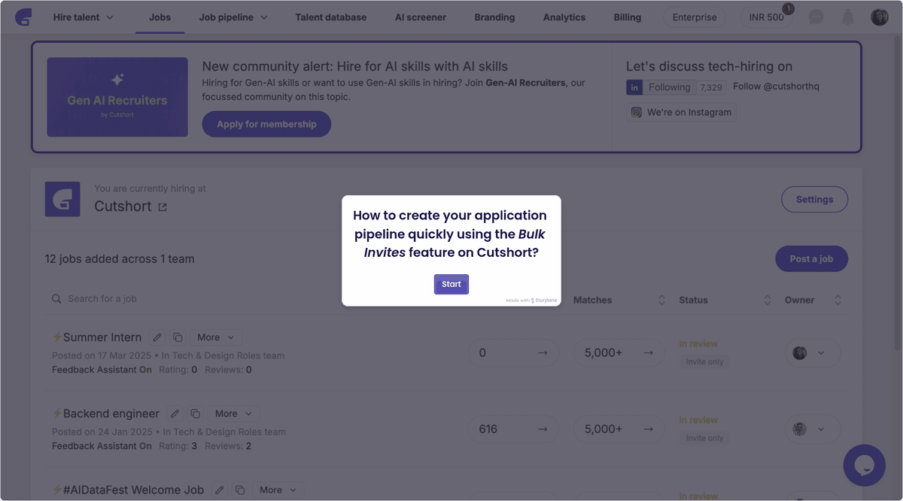

To increase your pipeline of applicants on your job, you can send bulk invites to select talent pool for your role.

## Send bulk invites

[Watch the walkthrough](https://app.storylane.io/share/e5e9a897-0dd7-4a30-b642-7beeddf9d388)

Just follow these simple steps:

1. Go to the [Talent Database](https://cutshort.io/profile/candidate-search/db) on Cutshort and start by putting filters or setting up criteria for the candidates you want to target for your job.
2. Once you have set the filters, save the search by clicking on the "Save this search" button on top right.
3. In the popup, make sure to check the box "Enable bulk invites". Select the job you want to invite the candidates to, and review the invitation message. Craft a compelling message to attract potential applicants. Press save.

That's it!

Cutshort will start sending out the invitations to the candidates via email and through our platform chat.

## What happens in the backend?

As the job invitations are being sent out to the candidates, our AI will automatically keep checking if the candidates are relevant to the job for which the invites are being sent. The candidates are skipped if they don't match your job criteria.

In case an invited candidate misses your message the first time, they will receive follow ups from our chatbot to respond back to you!

In a few hours, you will start receiving responses from candidates under your job pipeline [here](https://cutshort.io/profile/workflow). Engage with candidates promptly and provide a positive experience to attract top talent going ahead.
