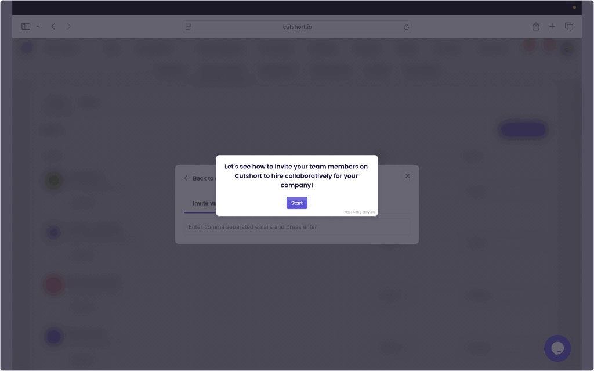

Recruiting team, hiring managers and founders can hire together on Cutshort.

This is how you can invite team members:

[Watch the walkthrough](https://app.storylane.io/share/ayu4dq0h49p6)

1. Log in to your Cutshort account and go to **Settings** > **Users and teams** — [https://cutshort.io/profile/hiring-settings/teammates](https://cutshort.io/profile/hiring-settings/teammates)

2. Click on **Invite user**

3. Select the role **Admin** if you wish to give full hiring access to the person you are inviting. If your plan supports it, you can choose to invite and assign Hiring Manager or Interviewer roles to your team members.

4. Add the email addresses and press **Enter**.

5. Click on **Send Invite**.

The invite will get sent via email to the members you added. They can use the link to join your hiring workspace.

## FAQs

### What happens once you add "Rahul" from your team to your workspace?

- You and Rahul can work/shortlist on the same job collaboratively,
- Rahul can leave a note on an application for your reference and vice versa,
- Chances of duplicacy and double work reduces since you can see which candidates Rahul has already spoken to and so on.

### How does the pricing of user seats work?

Billing applies to your workspace and all users in the workspace enjoy the benefits of that workspace.

Usage is pooled together for the purpose of unlock limits and any other usage limits. This means, you don't need to allot the usage amongst the team members. All have the flexibility to use what they need.

### Why can't I join via the shared invite? It is giving me an error "You don't have permission to join this team".

This happens when you are already a part of an old workspace and are trying to join another one. To fix this:

1. Just go to settings: [https://cutshort.io/profile/hiring-settings/company](https://cutshort.io/profile/hiring-settings/company)
2. Click on **Stop hiring for this company**
3. Select **Transfer and leave** (Note: All your old jobs will get removed)
4. Click on the invite link again to join successfully.
