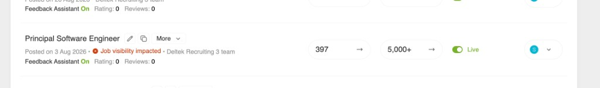
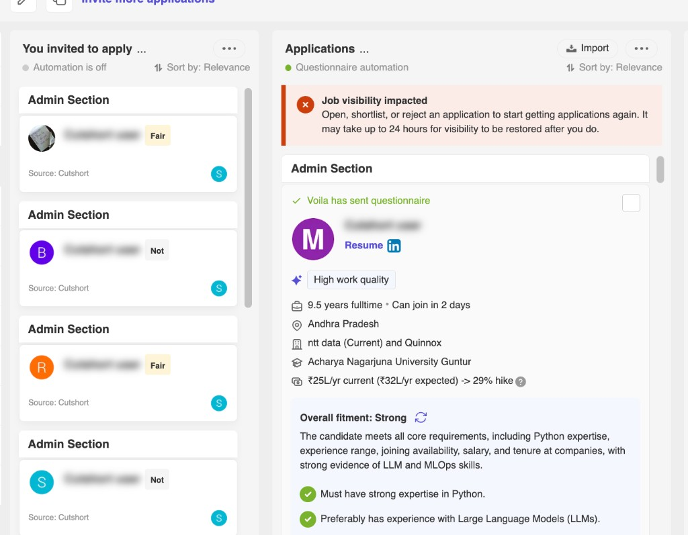

Candidates prefer jobs where recruiters actually respond. Cutshort looks at your **application review activity** on each job — and across your other jobs — and may **increase or reduce** how often that job shows up in the candidate feed.

Reviewing regularly helps you get more applications and protects your employer brand. If a job is shown less often, Cutshort tells you on **Jobs** and on the **Applications** screen.

## Why review activity matters

When applications sit unreviewed, candidates stop trusting the job — and often your company. Regular review activity helps in two ways:

- **More applications than usual** — jobs you keep working stay easier for candidates to find
- **Employer brand protection** — candidates are less likely to go around you to other teammates asking what happened to their application

## What Cutshort looks at

Cutshort looks at whether you are opening, shortlisting, or rejecting applications on a job, and at review patterns across your jobs. Based on that, it can raise or lower how often the job appears to candidates searching or browsing roles.

You do not need to change a setting for this. Keep reviewing applications on jobs you still want inbound on.

## Where you will see it

If a job’s visibility is reduced, you will see **Job visibility impacted** in two places:

**On Jobs** ([cutshort.io/profile/employer-dashboard](https://cutshort.io/profile/employer-dashboard)), next to the job:

**On the job’s Applications screen**, as a banner at the top:

The job can still be **Live**. **Job visibility impacted** means candidates are seeing it less often — not that you turned the job off.

## How to restore visibility

Open a job that shows **Job visibility impacted**, then **open**, **shortlist**, or **reject** an application.

Visibility restores **automatically** after you start reviewing again. It may take **up to 24 hours** for the job to show normally in the candidate feed.

You do not need to turn the job off and on, or contact support, for a normal restore.

## What to aim for

On jobs you still want applications for, review applications at least once a week. If a queue has piled up, clear some of it now so those jobs keep getting inbound.

## If something goes wrong

- **I reviewed applications but the banner is still there** — wait up to 24 hours. Keep reviewing on that job in the meantime.
- **The job is Live but applications dropped** — check for **Job visibility impacted** on **Jobs** or the **Applications** screen, then open, shortlist, or reject an application.
- **I no longer want candidates on this role** — turn the job off from **Jobs** so it stops appearing for other reasons too.

Something else? Chat with us on [cutshort.io](https://cutshort.io).

## Related

- [How do I post jobs to build a top candidate pipeline quickly?](/employers/post-job-build-pipeline)
- [How do I search relevant candidates on Cutshort?](/employers/search-relevant-candidates)
